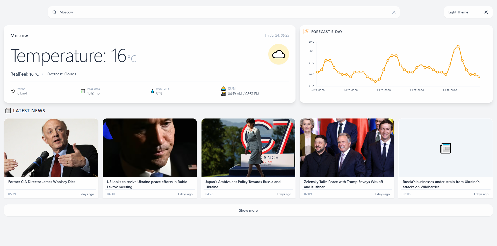
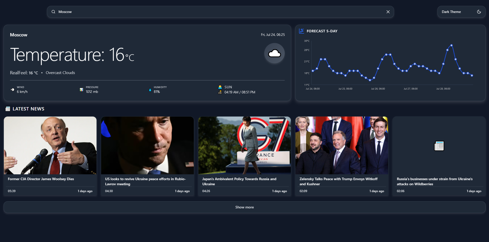
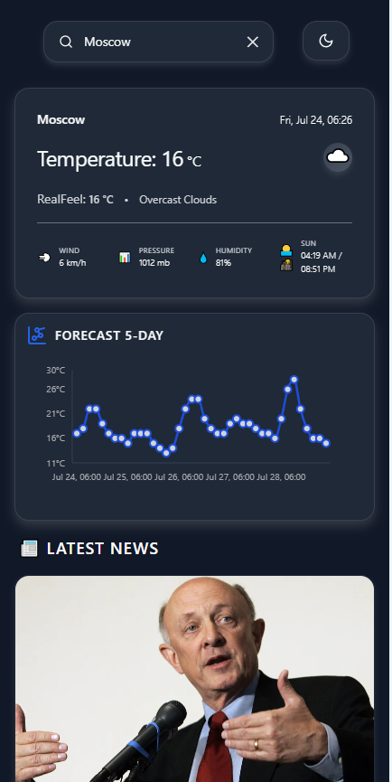

# Weather & News Dashboard

A modern weather forecast application with weather forecasts and news updates, 
built with React, TypeScript, and Tailwind CSS.

## ✨ Features
- 🌍 Search weather by city name
- 📊 5-day temperature forecast (Recharts)
- 🌙 Dark / Light theme toggle
- 📰 Latest news with "Show more"
- 💾 Last city saved in localStorage
- 📱 Mobile-optimized

## 🛠️ Tech Stack
- React 19.2.7 + TypeScript 6.0.3
- Vite (build tool)
- Tailwind CSS 3.4.19 (styling)
- Recharts (charts)
- Lucide React (icons)
- Vercel (deployment)

## 📷 Screenshots

|           Light Theme           |           Dark Theme          |        Mobile (iPhone XR)         |
|---------------------------------|-------------------------------|-----------------------------------|
|  |  |  |

## 🚀 Getting Started
```
bash
git clone https://github.com/Notify4660/weather-news-app.git
cd weather-app
npm install
npm run dev
```

## 🔗 APIs
- [OpenWeatherMap](https://openweathermap.org/)
- [NewsAPI](https://newsapi.org/)

## 📂 Project Structure
```
src/
├── api/          # API services
├── assets/       # Images
├── components/   # React components  
├── contexts/     # ThemeContext
├── hooks/        # useDebounce
└── utils/        # Helpers
```

## 🌐 Demo
[Live Demo]([https://your-app.vercel.app](https://weather-news-app-kohl.vercel.app/))

## 📅 Timeline

- **Started:** July 1, 2026
- **Break(personal reasons):** July 11-23, 2026
- **Finalized:** July 24, 2026

## 👨‍💻 Author
Notify4660 — [GitHub](https://github.com/Notify4660)
